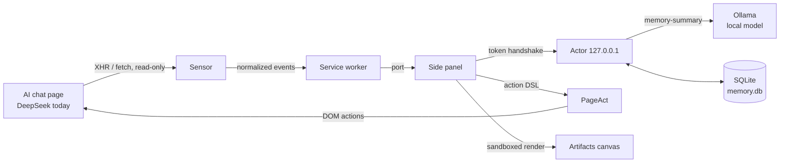
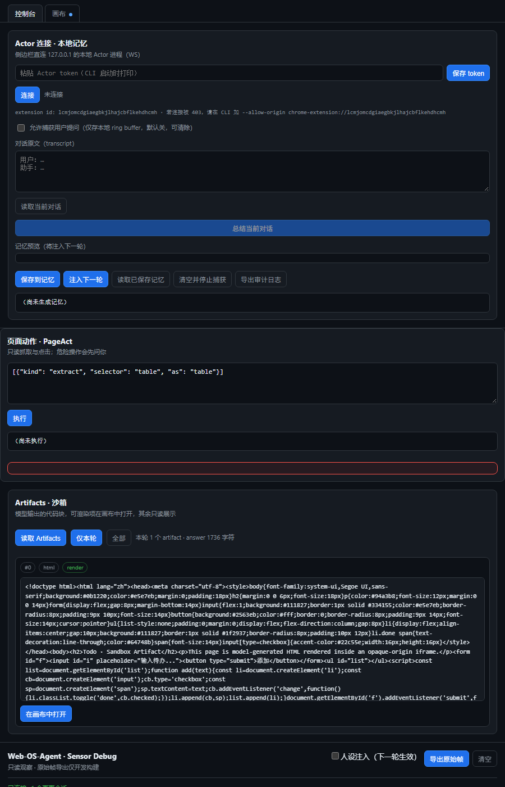
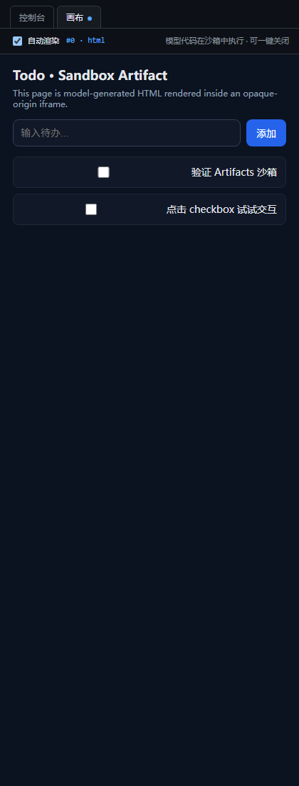

# Web-OS-Agent

> **Give every AI chat hands, memory, and a workspace — locally.**

Web-OS-Agent turns the AI chat page you already use into an agent runtime. It reads the page's own network stream (no API keys, no credentials), keeps long-term memory in a local SQLite database, acts on the current page through a declarative action DSL, and renders model-generated HTML/SVG/JSX inside an opaque-origin sandbox.

No cloud. No relay. No account. The model, the memory, and the execution loop stay on your machine — while the AI you already use stays exactly where it is.

<p>
  
  
  
  <a href="https://github.com/BOHAOYUAN/WEB-Agent-OS/actions/workflows/verify.yml"></a>
</p>

<details>
<summary>中文简介（点击展开）</summary>

Web-OS-Agent 把 AI 网页端变成 Agent 运行时：只读地观察你自己浏览器里已经发出的请求，把流拆成结构化事件，用本地模型压成结构化记忆存进 SQLite，再把「记忆 + 人设」作为前缀注入下一轮；模型生成的 HTML / SVG / JSX 在 opaque-origin 沙箱里渲染，出不了网，也碰不到扩展的 token 与存储；页面操作走声明式动作 DSL，危险动作必须经你确认。

- 不用 API key，不碰账号 / Cookie / Token / PoW；
- 本地优先：模型、记忆、执行都在本机；
- 四层解耦：Sensor → Router → Actor → UI，加上 PageAct 与 Artifacts 画布。

MIT，开源共建。

</details>

---

## Why this exists

The browser is where work happens. Yet the most capable AI on your machine — the chat page — is read-only: it can talk, but it cannot act. Every attempt to fix that so far has meant shipping your screen, your pages, and your data to a vendor.

We think that trade is wrong. The web is the largest GUI ever built, and it should be programmable by the person at the keyboard. That needs a runtime that is **local by construction**: it observes what your browser already sends, remembers locally, and executes through explicit, reviewable actions.

Web-OS-Agent is that runtime. It is **not** a browser, **not** a cloud agent, and **not** an automation framework. It is a thin, auditable layer between the AI you use and the machine you own.

## What it does

| Capability | What it does | Status |
|---|---|---|
| **Sensor** | Read-only capture of the page's own XHR/fetch, SSE framing, per-request normalization. Never reads auth. | ✅ stable |
| **Router** | Intent rules + persona injection with a hard loop guard; failure falls back to sending the original request. | ✅ stable |
| **Actor** | Local WebSocket bridge on `127.0.0.1`: token handshake, origin allowlist, rate limiting, audit trail, allowlisted local commands. | ✅ stable |
| **Memory** | Capture → summarize with a local model → save to `~/.webos-agent/memory.db` (SQLite) → inject into the next turn as a merged `SystemContext`. | ✅ stable |
| **PageAct** | Declarative action DSL (click / fill / scroll / extract / waitFor / nextPage / export). Dangerous actions require explicit confirmation; no arbitrary JS, ever. | 🟡 beta |
| **Artifacts canvas** | Fenced code blocks become a live right-hand stage: html/svg/JSX rendered in a nested opaque-origin iframe, with interaction results flowing back into the next turn. | ✅ stable |
| **Brain** | Browser-local inference channel (WebGPU). Model choice is measured, not assumed — see `docs/brain-ab-report.md`. | 🟡 experimental |

## Design principles

1. **Local by construction.** If a feature cannot run on the user's machine, it does not belong in the core.
2. **Never touch auth.** No cookies, no tokens, no `Authorization` headers, no PoW, no request replay.
3. **Declarative, not arbitrary code.** The model emits a fixed vocabulary of actions; the executor performs them. There is no `eval` and no free-form script field.
4. **Fail closed.** No confirmation UI means "refuse". Unknown action means "refuse". A batch stops at the first surprise.
5. **Observable and auditable.** Every privileged decision — handshake, refusal, confirmation, rate limit — lands in an audit trail you can export.
6. **Open.** MIT, no telemetry, no backend service to trust.

## Architecture



The side panel is the only UI: a **console** (memory loop, PageAct console, artifacts list, sensor debug) and a **canvas** (the live artifact stage).

## See it working

<table>
  <tr>
    <td align="center"><br/><sub>Fenced code is detected and classified (html · render)</sub></td>
    <td align="center"><br/><sub>Model-generated HTML running in the sandbox canvas</sub></td>
  </tr>
</table>

> Captured with a real extension build in headless Edge against the local mock page — not a mockup.

## Quickstart

**Prerequisites:** Node.js ≥ 22, Chrome/Edge ≥ 116, and a local [Ollama](https://ollama.com) for memory summarization.

```bash
npm ci
npm run verify     # typecheck + lint + arch red-line scan + 430 tests + build
npm run build      # → dist/
```

1. Open `chrome://extensions`, enable **Developer mode**, load `dist/`.
2. Start the local Actor with `scripts/autostart.ps1` — it launches Ollama (if needed) and the Actor CLI, reading the token and extension id from `%LOCALAPPDATA%\WebOSAgent\` (generated on first run). Diagnostics: `npm run verify:sqlite`, `-DryRun` in [docs/autostart.md](docs/autostart.md).
3. Open `https://chat.deepseek.com`, sign in with **your own** account, open the side panel, paste the token from `%LOCALAPPDATA%\WebOSAgent\token.txt`.
4. Send a message: the panel captures the stream. Ask for an ```html or ```jsx block and open the canvas.

> The token is loopback-only and generated on your machine. It is never logged and never committed. The extension reads no cookies, tokens, or anti-bot headers.

## Repository layout

```text
packages/shared     contract layer: types, SSE decode, validation (pure TS)
packages/sensor     MAIN-world observe hooks + ISOLATED-world bridge
packages/router     intent rules + persona library + loop guard
packages/actor      local bridge: hand-rolled WS, token handshake, SQLite memory, audit
packages/page-act   action DSL + executor + confirmation registry
packages/ui         side panel panels: console, canvas, sandbox frame
packages/brain      browser-local inference channel (experimental)
apps/extension      manifest / service worker / side panel entry
apps/demo           local SSE + PageAct fixtures for offline verification
docs/               architecture, threat model, roadmap, runbooks
```

## Status

- **430 unit/integration tests** (+6 opt-in real-model tests with `ACTOR_E2E=1`), typecheck, lint, arch red-line scan and build all run in CI on every push.
- `v0.1.0` is tagged. `v0.2.0` is in progress: SQLite memory, PageAct (beta), the artifacts canvas, and a re-measured Brain plan.
- **Honest gaps:** only the current DeepSeek page version is supported; PageAct is driven from a JSON console (no model planner yet); auto-summary, memory retrieval and site adapters are not shipped; there is no visual/screenshot-based CUA, and there will not be.

## Roadmap

| Horizon | Focus |
|---|---|
| **Now (v0.2)** | Real-DeepSeek evidence run, PageAct end-to-end proof, canvas polish |
| **Next (v0.3)** | Auto-summary trigger (opt-in, preview-only), memory retrieval, indirect-prompt-injection hardening, first site adapters |
| **Later** | DOM pruning for planning, multi-site coverage, a desktop bridge |

## Security model

- The extension itself never makes network requests — the **only** connection is the side panel → Actor WebSocket, hard-pinned to `127.0.0.1`.
- Model output is untrusted: it renders inside `sandbox="allow-scripts"` **without** `allow-same-origin`, under a `default-src 'none'` / `connect-src 'none'` CSP. It cannot reach the extension's token, storage, or the network.
- Page actions are declarative and validated twice (service worker + content script). Dangerous ones (download / submit / credential / destructive) need explicit user confirmation; no UI listener means refusal.
- Full threat model, residual risks and non-goals: [docs/threat-model.md](docs/threat-model.md).

## Contributing

The project is built in the open and welcomes contributors.

**Good first issues**

- Add a **site adapter** for another AI chat (same read-only contract as `chat.deepseek.com`).
- Add **PageAct fixtures** — pages that exercise every danger classification, so the confirmation path stays honest.
- Improve **docs**: architecture notes, failure-mode write-ups, translations (Chinese ⟷ English).

**Ground rules**

1. Do not add network calls to the extension, a cloud relay, or credential access. Those are hard red lines.
2. No arbitrary JS execution in the action path. Extend the DSL and write a test instead.
3. Every PR must pass `npm run verify`. Behaviour changes need a test that would have caught the old behaviour.

```bash
npm ci
npm run verify      # the only gate
npm run demo        # local SSE + PageAct fixtures on :4318
```

We are at the beginning. If the idea of a local, auditable agent runtime for the web resonates with you, the fastest way to help is to use it on a page you care about and file what broke.

## License

MIT — see [LICENSE](LICENSE).
